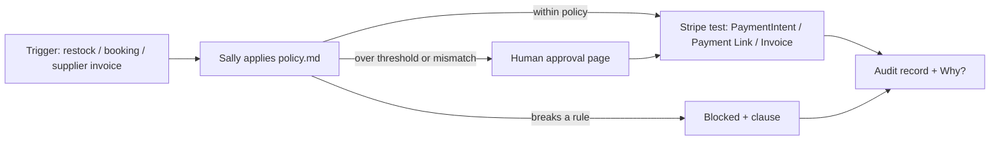

# 🥗 Sally for restaurants (HeySalad Off-Ramp)

One agent for a restaurant. A written policy (`policy.md`). Real money moving in **Stripe test mode**. Every pound explained.

## 3 one-click demos
1. **Restock** (spend): Sally restocks the kitchen (real Waitrose basket + Bidfood items). Within policy she pays automatically (PaymentIntent). Items over £25 wait for a human: tap **Approve & pay**. Wrong supplier / alcohol are blocked with the clause.
2. **Host booking** (collect): "Table for 6 Saturday 8pm". Rule H1: 6+ guests pay £10/head, so Sally creates a £60 Stripe **Payment Link**. No human raised the bill. Diner pays with 4242.
3. **Supplier invoice** (spend + collect): Sally checks the Bidfood invoice against PO-1042 (supplier, amount, limit), creates a finalized Stripe **Invoice** (hosted page + PDF) and pays it. A mismatched invoice waits for a human.

Every result has Stripe IDs/links, an audit trail, and a **Why?** button. `/audit` lists every pound with its reason.



## Run
```bash
npm install
echo "STRIPE_SECRET_KEY=sk_test_..." > .env   # test keys only; live keys are refused
npm run dev   # http://localhost:3000
```
Optional: `TWILIO_ACCOUNT_SID`, `TWILIO_AUTH_TOKEN`, `TWILIO_FROM` for SMS/voice at `/twilio/sms` and `/twilio/voice`. The original grocery off-ramp is still at `/shop`.

MIT licence.
