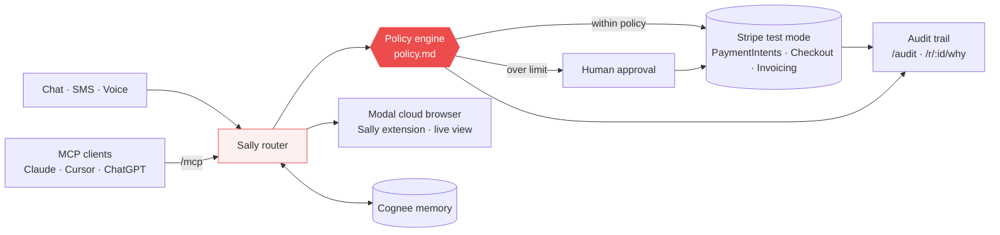
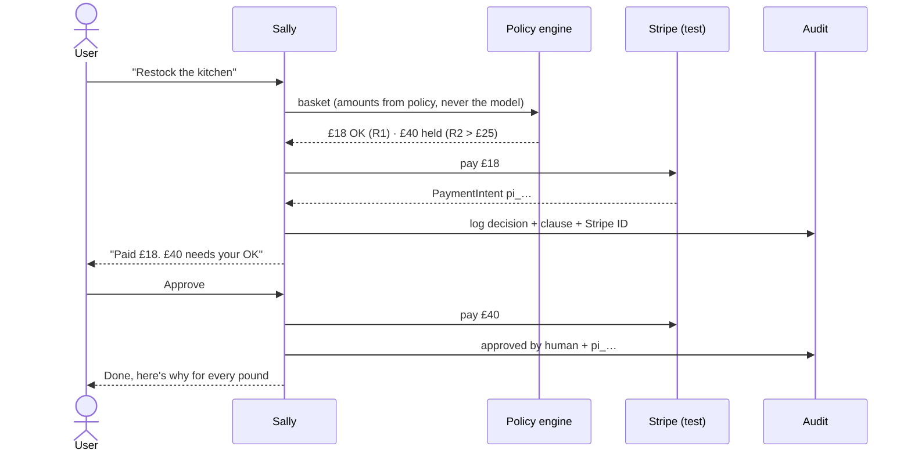

<p align="center"></p>

<h1 align="center">Sally by HeySalad</h1>
<p align="center"><b>The AI agent that spends your money like you would, and can explain every pound.</b></p>

<p align="center">
  <a href="https://drive.google.com/file/d/1ZCSo90Dt93hS0RibHrhlArkdVBAGAlqh/view"></a>
  <a href="https://peter-36009--agent-offramp-web.us-east.modal.run"></a>
  
  
</p>

Sally restocks the kitchen, takes deposits, pays supplier invoices and shops real grocers in her own cloud browser. She works by chat, SMS, voice or any MCP client. Every action passes a written spending policy **before** Stripe is touched. Anything over the limit waits for a human, and every pound gets an audit trail that cites the policy clause behind it.

**Watch:** [1:59 demo video](https://drive.google.com/file/d/1ZCSo90Dt93hS0RibHrhlArkdVBAGAlqh/view) · **Try:** [peter-36009--agent-offramp-web.us-east.modal.run](https://peter-36009--agent-offramp-web.us-east.modal.run) · **Track:** Agents that spend

## Features
| | What Sally does | Stripe |
|---|---|---|
| 🛒 **Restock** | Builds the basket, auto-pays items within policy, holds anything over £25 for approval | PaymentIntents |
| 🍽️ **Bookings** | Groups of 6+ get a £10/head deposit link, and allergies go to staff | Payment Links / Checkout |
| 🧾 **Supplier invoices** | 3-way PO check, then pays. Mismatches wait for a human | Invoicing |
| 📤 **Bill customers** | Drafts and sends invoices. Over £500 needs approval | Invoicing |
| 🤖 **Autonomous shop** | Shops Ocado and Waitrose live in a Modal cloud browser, basket only | n/a |
| 🧠 **Memory** | Remembers preferences, past orders and spend decisions with Cognee | n/a |
| 🔌 **Use Sally in your AI** | 10 tools over MCP (`/mcp`) for Claude, Cursor, ChatGPT and more | Agent toolkit |
| 🔍 **Explains every pound** | `/audit`, `/r/:id/why` and a live audit panel | IDs on every line |

## Architecture


## A spend, with approval and audit


## Stripe features used
| Feature | Status | Where in the code |
|---|---|---|
| **Payments** (PaymentIntents) | ✅ Built | Restock auto-pay and approved items, autonomous shop (`restaurant.ts`, `shop.ts`) |
| **Checkout** | ✅ Built | `checkout.sessions.create` for approvals and payments (`server.ts`) |
| **Payment Links** | ✅ Built | Booking deposits for 6+ (`restaurant.ts`) |
| **Invoicing** | ✅ Built | Supplier invoices created, finalised and paid, plus customer invoices drafted and sent (`restaurant.ts`) |
| **Agent toolkit / MCP** | ✅ Built | `@stripe/agent-toolkit` plus Sally's 10 tools at `/mcp` (`mcp.ts`, `toolkit.ts`) |
| **Issuing** (virtual cards) | 🛣️ Roadmap | Per-task cards with policy-scoped limits |
| **Connect** | 🛣️ Roadmap | Pay suppliers as connected accounts |
| **Billing** | 🛣️ Roadmap | Subscriptions for Sally plans |
| **Shared payment tokens** | 🛣️ Roadmap | Agentic checkout at grocers |

Stripe test mode only: `sk_test_` is enforced at deploy.

## How we built it
- **Stack:** Node 20 + TypeScript (Express via `tsx`), with one chat UI (`public/chat.html`). Twilio handles SMS and voice, and OpenAI Realtime handles talking to Sally.
- **Policy engine:** `policy.md` rules (R1–R4, H1, I1–I4, S1) run in code **before** any Stripe call. Amounts come from policy and the basket, never the model, and anything over a limit goes to human approval.
- **Stripe test mode:** real test objects (PaymentIntents, Checkout Sessions, Payment Links, Customers, Invoices), with webhooks confirming payment.
- **Audit log:** every decision is appended with its policy clause and Stripe ID, shown live in the panel, at `/audit` and at `/r/:id/why`.
- **MCP:** Sally is an MCP server (stdio + Streamable HTTP `/mcp`) with 10 tools: restock, book_table, pay_supplier_invoice, prepare_invoice, send_invoice, email_shopping_list_draft, approve, get_audit, get_policy and shop. Every tool calls Sally's own API, so the policy can't be bypassed.
- **Modal:** the app runs on Modal (`modal_app.py`, with a volume-backed `data/`). Sally's cloud browser is a Modal sandbox running Playwright Chromium, the Sally extension and a noVNC live view, which shop Ocado and Waitrose basket-only.

## Cognee memory
Sally stores shopping preferences, past orders and spending decisions in [Cognee](https://cognee.ai) and recalls them when she plans a shop or explains a spend. Set `COGNEE_API_KEY` and `COGNEE_BASE_URL` (your tenant URL). Without them, Sally falls back to her local store, so the demo never blocks.

## Brand
 HeySalad red `#ed4c4c` ·  ink `#111111` · white

---

Built on **Stripe Agent Toolkit — [github.com/stripe/ai](https://github.com/stripe/ai)** (`@stripe/agent-toolkit`, MIT). Stripe test mode only. MIT licensed.

## 3 demos (type them in the chat, or text/call the Twilio number)
1. **Restock the kitchen** — Sally builds the basket, pays what is within policy (R1–R4), holds anything over £25 (R2), blocks alcohol and unapproved suppliers. Tap **Approve & pay** (or text `YES <id>`) for the rest.
2. **Table for 6 Saturday 8pm** — groups of 6+ get a £10/head deposit Stripe Payment Link (H1). No human raises the bill. Allergy mentions go to staff.
3. **Pay the Bidfood invoice** — Sally checks supplier + purchase order (I1–I3), then creates and pays a Stripe invoice. Mismatches wait for a human.

## How it maps to judging
| Criterion | Where |
|---|---|
| Money moves in Stripe test mode | PaymentIntents, Payment Links, Customers, Invoices + invoice items: real test objects |
| Autonomy within policy | `policy.md` rules run in code **before** any Stripe call; amounts come from policy, never the model; over-limit → human |
| Explains every pound | Live audit panel, `/r/:id/why`, `/audit`, every line cites a clause |
| Product & creativity | One agent across chat, SMS and voice for a real restaurant |

## Quickstart
```bash
npm install
cp .env.example .env   # STRIPE_SECRET_KEY=sk_test_...
npm run dev            # http://localhost:3000
```

## Twilio (SMS + voice)
Set `TWILIO_ACCOUNT_SID`, `TWILIO_AUTH_TOKEN`, `TWILIO_PHONE_NUMBER`, `PUBLIC_URL` in `.env`. On the number in the Twilio console:
- Messaging webhook: `POST {PUBLIC_URL}/sms`
- Voice webhook: `POST {PUBLIC_URL}/voice`

Requests are signature-checked when `TWILIO_AUTH_TOKEN` is set. Phone triggers appear live in the web chat.

## For other agents
See [AGENTS.md](AGENTS.md): `POST /api/chat {"text": "..."}`.

## Voice (talk to Sally)
Tap the mic in the composer. With `OPENAI_API_KEY` set, the browser opens an **OpenAI Realtime** (`gpt-realtime`, WebRTC) session using a 2-minute ephemeral secret from `POST /api/realtime/session`; the key never leaves the server. The model only picks a tool (`restock`, `book_table`, `pay_supplier_invoice`, `prepare_invoice`, `send_invoice`, `email_shopping_list_draft`, `approve`); the browser runs it through `/api/chat`, so policy and Stripe calls stay server-side. Sessions auto-stop after 2 minutes idle. Without a key it falls back to the browser Web Speech API (en-GB) + speechSynthesis.

Try: "prepare an invoice for Acme Ltd £120 for catering", "send the invoice", "do the shopping", "email me the shopping list" (draft only, never sent).

## Use Sally in your AI

Sally is also an MCP server, so Claude, Cursor, Codex and ChatGPT can use her as a plugin. Every tool calls Sally's own API, so `policy.md` is enforced on the server: an AI can ask, but it can't override the policy.

Tools: `restock`, `book_table`, `pay_supplier_invoice`, `prepare_invoice`, `send_invoice`, `email_shopping_list_draft`, `approve(id)`, `get_audit`, `get_policy`. Each one returns a short summary, the record as JSON and the Stripe link.

- **stdio:** `SALLY_URL=http://localhost:3000 npx tsx src/mcp.ts` (run `npm run dev` first)
- **HTTP (Streamable):** `<PUBLIC_URL>/mcp`

**Claude Desktop** (`claude_desktop_config.json`) and **Cursor** (`.cursor/mcp.json`):
```json
{ "mcpServers": { "sally": { "command": "npx", "args": ["tsx", "/path/to/agent-offramp/src/mcp.ts"], "env": { "SALLY_URL": "http://localhost:3000" } } } }
```
**Claude Code:** `claude mcp add --transport http sally <PUBLIC_URL>/mcp`
(or locally: `claude mcp add sally -e SALLY_URL=http://localhost:3000 -- npx tsx src/mcp.ts`)

**Codex** (`~/.codex/config.toml`):
```toml
[mcp_servers.sally]
command = "npx"
args = ["tsx", "/path/to/agent-offramp/src/mcp.ts"]
env = { SALLY_URL = "http://localhost:3000" }
```
**ChatGPT:** Settings → Connectors (developer mode) → add a custom connector with the URL `<PUBLIC_URL>/mcp`.

To test it, run `npx tsx scripts/mcp-test.ts`. This lists the tools and calls `restock` and `get_audit` over both stdio and HTTP.

## Next

- **Sally Spend** ([github.com/Hey-Salad/sally-spend](https://github.com/Hey-Salad/sally-spend)): a Stripe Issuing test virtual card whose per-payment and monthly limits and MCC allowlist are enforced by the card itself, plus an audit that cites the policy clause for each decision.
