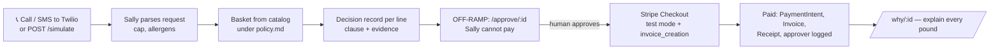

# 🥗 Off-Ramp — open-source agent off-ramping for Stripe

**Agents shop. Humans pay. Every pound explained.**

AI agents can now pick what to buy, but handing them a card is scary. **Off-Ramp** is the moment an agent *stops*: it builds a basket under a written policy, then hands a human a ready-to-approve Stripe Checkout with every line justified. After payment you have a Stripe PaymentIntent, an Invoice, a receipt and a full audit trail — linked to each other by metadata.

Demoed with **Sally**, HeySalad's shopping agent. Built for Briefcase × Stripe hackathon (Oct 2026). Stripe **test mode only** — the server refuses live keys.

## Flow


## Policy (`policy.md`)
P1 weekly cap £40 (max £50) · P2 single item > £15 needs human tick · P3 no alcohol · P4 allergen rules (“no nuts”) · P5 allowed merchants Ocado/Waitrose · P6 agent never moves money · P7 every line gets a decision record.

## Run
```bash
npm install
cp .env.example .env   # add your sk_test_ key
npm run dev            # http://localhost:3000
```
- Open `/`, click **Ask Sally**, review, **Approve & pay**, use card `4242 4242 4242 4242`.
- API: `POST /simulate {"text":"Weekly shop under £40, no nuts","from":"+44..."}`
- Twilio: point Voice webhook to `PUBLIC_URL/twilio/voice`, Messaging to `PUBLIC_URL/twilio/sms` (use a tunnel such as `cloudflared tunnel --url localhost:3000`).
- Stripe webhook (optional): `stripe listen --forward-to localhost:3000/stripe/webhook`.

## Endpoints
| | |
|---|---|
| `POST /simulate` | trigger a run |
| `POST /twilio/voice`, `/twilio/sms` | phone triggers; SMS reply carries the approval link |
| `GET /approve/:id` | human approval environment |
| `POST /approve/:id` | creates Checkout Session (with invoice) |
| `GET /why/:id?sku=` | “why did you pay / block this?” |
| `GET /api/records/:id` | full audit JSON |

## Memory
`src/memory.ts` exposes a `CogneeMemory` adapter: local JSON is the source of truth; if `COGNEE_URL`/`COGNEE_API_KEY` are set, records are also pushed to Cognee.

MIT licensed.
