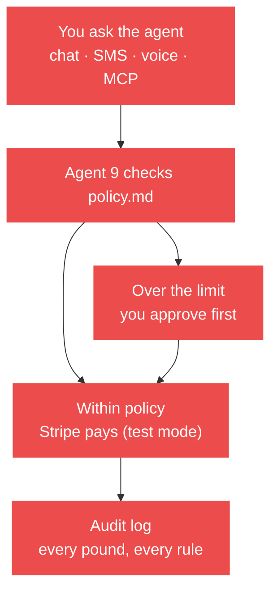

<p align="center">
  <picture>
    <source media="(prefers-color-scheme: dark)" srcset="assets/logo-dark.svg">
    <source media="(prefers-color-scheme: light)" srcset="assets/logo-light.svg">
    
  </picture>
</p>

<h1 align="center">Agent 9</h1>
<p align="center"><b>9 Stripe products vs 1. We lost. Here's the code.</b></p>
<p align="center">Spend rules and virtual cards for AI agents. Open source, by HeySalad.</p>

<!-- HERO: add assets/demo.gif (15–20s: the agent shops, then the card declines £80), then uncomment:
<p align="center"></p>
-->

Write your agent's spending rules in plain English in [`policy.md`](policy.md). Agent 9 checks every spend against them **before** Stripe is touched, then a Stripe Issuing virtual card enforces the same limits again at the card network. The AI can ask; it can't override. The example agent in the demo is Sally, who restocks a kitchen.

## Use it three ways

**1. In your AI (MCP).** Works with Claude, Cursor, Codex and ChatGPT.
```bash
npm install && npm run dev                      # start Agent 9 on :3000
claude mcp add sally -e SALLY_URL=http://localhost:3000 -- npx tsx src/mcp.ts
```
Cursor / Claude Desktop:
```json
{ "mcpServers": { "sally": { "command": "npx", "args": ["tsx", "/path/to/agent-offramp/src/mcp.ts"], "env": { "SALLY_URL": "http://localhost:3000" } } } }
```
Or point any MCP client at `<your-url>/mcp` (Streamable HTTP).

**2. Run locally.**
```bash
cp .env.example .env    # add a Stripe TEST key (sk_test_...)
npm install && npm run dev
open http://localhost:3000
```

**3. Self-host on Modal.** Put your keys in Modal secrets (see `modal_app.py`), then `modal deploy modal_app.py`. Agent 9 refuses to start with a live key.

## Try to make Sally overspend
These are real cases from the code. Run them and watch them fail.

| You try | Sally says | Rule |
|---|---|---|
| £80 on her card at Ocado | Declined by Stripe: over £50 per authorisation | P2 + Issuing spending controls |
| £10 at an off-licence | Declined by Stripe: category not allowed | P3 + Issuing allowed categories |
| Wine in the restock | Blocked: no premises licence | R4 |
| Truffle oil from Amazon | Blocked: not an approved supplier | R3 |
| £32.50 olive oil | Held for your OK: over £25 per item | R2 |
| Supplier invoice with a £35 surcharge not on the PO | Held: invoice doesn't match the purchase order | I2 |
| Send a £600 customer invoice | Held: over £500 needs approval | I4 |
| Shared payment token over its limit | Refused before Stripe is called | P2 |
| “Table for 8, one nut allergy” | Goes to staff, not the agent | H2 |

Found a way round the policy? [Open an issue](../../issues) with the prompt. That's a bug, and we want it.

## The 16 MCP tools
`restock` · `shop` · `book_table` · `pay_supplier_invoice` · `prepare_invoice` · `send_invoice` · `email_shopping_list_draft` · `approve` · `get_audit` · `get_policy` · `remember` · `recall` · `issue_card` · `pay_venue` · `subscribe_sally_plus` · `pay_with_shared_token`

Every tool calls Agent 9's own API, so `policy.md` always runs server-side.

## See the money
Every Stripe object has a page, linked from the top nav: `/money` (overview), `/payments` and `/receipt/:id`, `/card` (Issuing authorisations), `/invoices`, `/billing`, `/connect`, `/audit`. Each one links to the matching test-mode object in your Stripe dashboard.

## Make it yours
- Fork [`examples/policy.md`](examples/policy.md) and change the numbers.
- Walkthroughs: [restock](examples/restock.md) · [booking deposit](examples/booking-deposit.md) · [supplier invoice](examples/supplier-invoice.md) · [grocery shop](examples/grocery-shop.md)
- Calling Agent 9 from another agent: [AGENTS.md](AGENTS.md) · for LLMs: [llms.txt](llms.txt)

## How it works

## The 9 Stripe products
PaymentIntents · Checkout · Payment Links · Invoicing · Issuing · Connect · Billing · shared payment tokens · [Agent Toolkit](https://github.com/stripe/ai). Test mode only. Memory: [Cognee](https://cognee.ai) (optional).

[Contributing](CONTRIBUTING.md) · MIT licence · Built by [HeySalad](https://heysalad.io)
