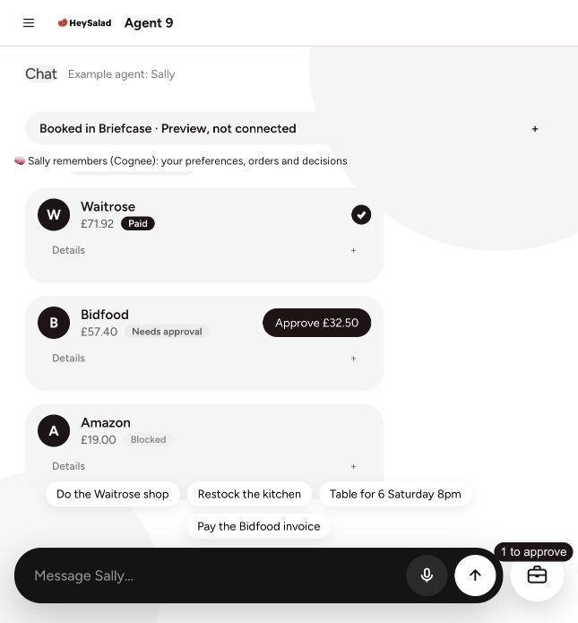
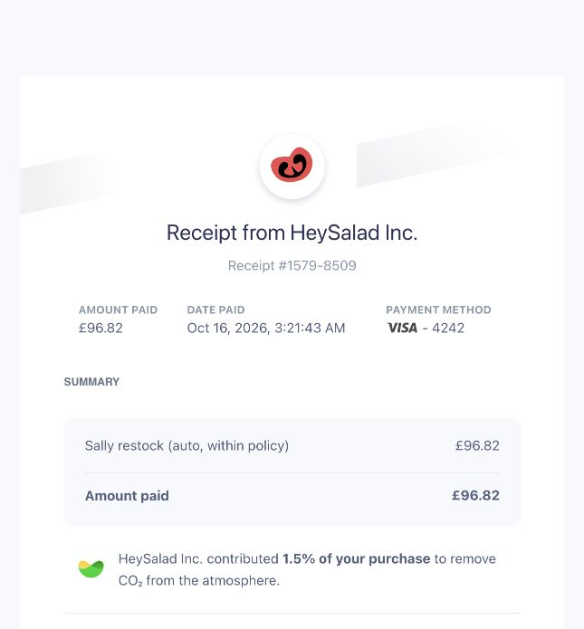
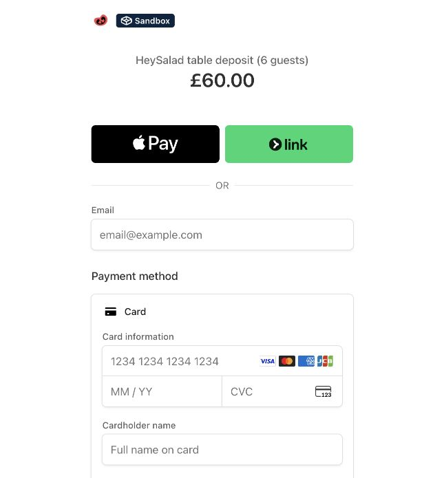
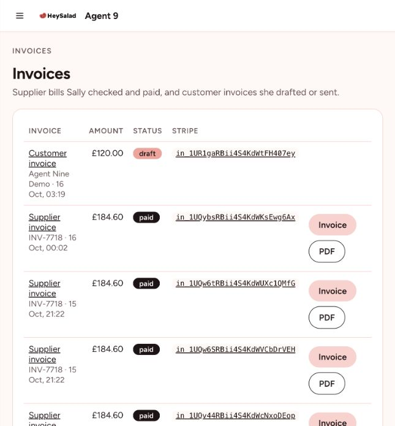
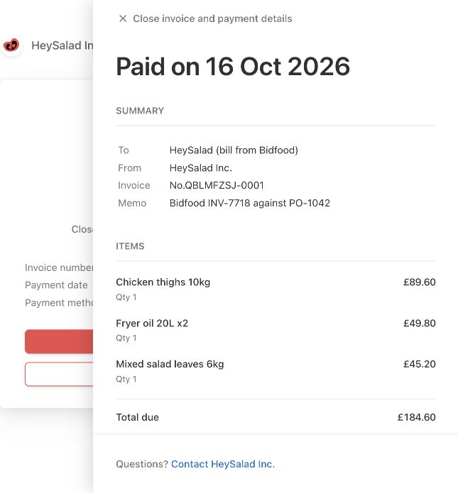

# Original-interface demo walkthrough

Browser-driver exploration of the original hosted Agent 9 app, verified on 16 October 2026. All financial activity and pages below are Stripe test mode. This supplements the nine-product overview with customer-facing screens and concrete business journeys.

The working test links are saved locally in the ignored `demo/work/walkthrough/guide.md` and `links.json`. The app origin stays in APP_URL. Record URLs below are relative to that origin. No Stripe Dashboard login is needed for the routes described here.

| Journey | Start in the original interface | Result to show | Verified outcome |
| --- | --- | --- | --- |
| Restock and receipt | Chat → **Restock the kitchen** | Supplier cards → **Receipt** → **Stripe receipt** | Fresh £96.82 payment succeeded; Stripe receipt #1579-8509 |
| Booking and checkout | Chat → **Table for 6 Saturday 8pm** | **Open link** → Stripe-hosted checkout | Six guests × £10 = £60; Sandbox page, payment not completed |
| Customer invoice draft | Chat → `prepare an invoice for Agent Nine Demo 120 for catering` | **Invoices** list → £120 draft row | New `in_` invoice shown with draft status; no invoice email sent |
| Supplier invoice and documents | **Invoices** → existing £184.60 supplier record | Policy checks → **Stripe invoice** → payment details/downloads | Invoice #QBLMFZSJ-0001 paid, £0 remaining, three line items |

## 1. Restock → approval boundary → receipt

1. Open Chat and choose **Restock the kitchen**.
2. Hold on the three supplier cards: Waitrose **£71.92 Paid**, Bidfood **£57.40 Needs approval**, Amazon **£19 Blocked**.
3. Expand the supplier details to show the items and the rule behind each decision. The Bidfood approval button is **£32.50**: its other £24.90 line was already allowed automatically.
4. Leave the £32.50 held item awaiting approval for this walkthrough. The automatic test payment totals **£96.82 = £71.92 Waitrose + £24.90 Bidfood**. Do not describe that receipt as Waitrose alone.
5. Open the current record's **Receipt**, scroll the itemised lines and rule citations, then click **Stripe receipt**.
6. Show Stripe's actual receipt, including the amount paid, date, receipt number and test payment's last four digits.

Observed app receipt: `/receipt/restock_4d15c2df`. The Stripe-hosted receipt is marked TEST in its page title. The record can also be reached through Payments → Receipt; its Stripe object link is a Dashboard link, so use the separate **Stripe receipt** link instead.

[Full itemised app receipt screenshot](walkthrough/itemised-receipt.jpg)

Suggested narration: “Sally restocks within our rules. Anything needing approval waits. Here is the receipt.”

## 2. Booking → deposit link → real checkout

1. Return to Chat and choose **Table for 6 Saturday 8pm**.
2. Show Sally's **Deposit link ready** response and the £60 guest-booking card.
3. Open Details to show H1: groups of six or more require £10 per guest.
4. Click **Open link** to visit the actual Stripe-hosted payment page.
5. Hold on **Sandbox**, **HeySalad table deposit (6 guests)**, and **£60.00**. The checkout offers email/card entry and a Pay button.
6. This walkthrough stops at the unpaid checkout. A paid booking can be shown later as a separate, already-completed test example; do not imply the link has collected a deposit.

Observed booking record: `/r/booking_50e21fe3`. Its public test payment link is in the local links guide. A Payment Link leads to Stripe Checkout: these are two stages of this same customer journey.

The app card says **Link sent**. This browser session verified creation/opening of the link; it did not demonstrate delivery by email or SMS. Use “link ready” in the demo narration.

Suggested narration: “For a group booking, Sally prepares the deposit link. This is what your customer sees.”

## 3. Customer request → draft invoice

1. In Chat, enter `prepare an invoice for Agent Nine Demo 120 for catering`.
2. Show the **£120 Draft** card. The separate **Send £120.00** control is a later action, and was not used.
3. Open the navigation and go to **Invoices**. On narrow screens, open the hamburger menu before choosing the page.
4. Show **Agent Nine Demo**, **£120.00**, **draft**, and its `in_` identifier in the invoice list. The new invoice is `in_1UR1gaRBii4S4KdWtFH407ey`.
5. Keep draft and sent/paid states distinct. The draft currently has no public hosted invoice/PDF link displayed in this interface.

Observed draft record: `/r/outinvoice_bf2e8c1e`.

**Display gap found:** the full record currently says “No Stripe object yet” even though the Invoices list shows the actual draft's ID and status. Source inspection confirms `recordPage()` selects `stripe.invoice` or `stripe.sent`, omitting `stripe.draft`. Its generic empty-links message also confuses “no hosted document link” with “no Stripe object.” Use the working Invoices list for now; fixing/deploying that detail page is separate work. The audit records Toolkit customer, invoice and invoice-item operations, and “Draft only, nothing sent.”

Suggested narration: “Sally turns your request into a draft invoice, ready for you to review.”

## 4. Supplier checks → paid invoice → downloadable documents

1. Open **Invoices**, then the existing paid **£184.60** supplier invoice record.
2. Show the three matched lines: chicken thighs £89.60, fryer oil £49.80 and salad leaves £45.20.
3. Show the audit's three checks: approved supplier, exact match against PO-1042, and within the £250 automatic-payment limit.
4. Open **Stripe invoice**, which is a public test invoice page rather than the Dashboard.
5. Show **TEST MODE**, **Invoice paid**, **£184.60**, invoice number **QBLMFZSJ-0001** and the payment date.
6. Expand **View invoice and payment details** to show the memo, line items, amount paid and £0 remaining.
7. Point out **Download invoice** and **Download receipt**. The app also has a direct **PDF** link.

Observed record: `/r/invoice_939e288e`. This is an existing completed example, not a new payment made during this walkthrough.

The hosted test invoice is issued **by HeySalad Inc. to “HeySalad (bill from Bidfood)”**, with memo “Bidfood INV-7718 against PO-1042.” It represents the supplier-bill scenario; do not describe it as an invoice issued by Bidfood's own Stripe account.

Suggested narration: “Sally checks the supplier bill against the order. The paid invoice and receipt stay together.”

## Useful direction for the next cut

Show a short causal sequence for each business task: **request → rule/approval → action → actual invoice, checkout or receipt → audit**. Use the original chat and records to explain the action; use the hosted page to show its customer-facing result. Keep technical object IDs as supporting proof rather than the only visible outcome.

A detailed walkthrough can accompany the existing 59-second nine-product overview. The combined cut now adds fresh, real chat-first versions of these journeys before the overview's closing slate. The original overview is preserved under `demo/out/overview/`. No hosted deployment is implied. Screenshots are authentic browser-driver captures of the original interface, with its existing styling.
